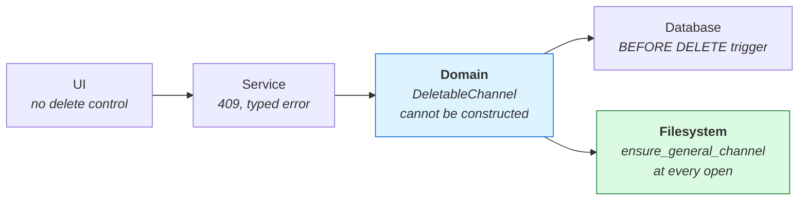
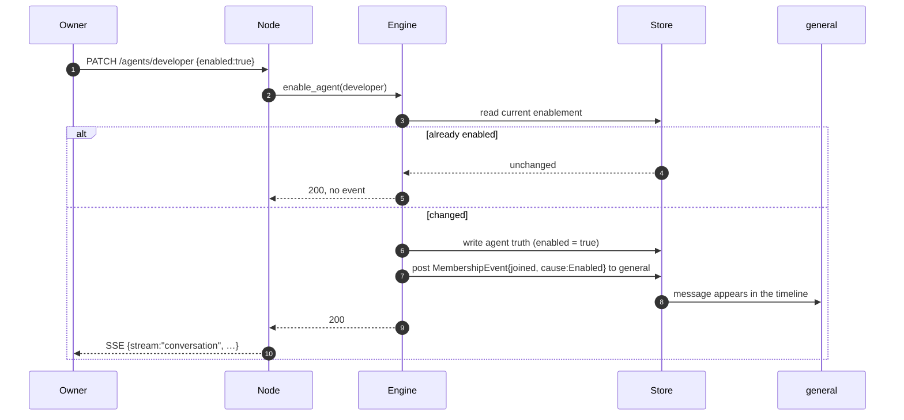

# 05 — Channels

A **channel** is a standing conversation the workspace can see. A **direct message** is a
conversation with a restricted audience. Both are one stored object and one wire kind, because they
are the same act; only the audience differs.

---

## The model

```rust
pub struct Channel {
    pub id: ChannelId,
    pub name: String,
    pub topic: Option<String>,
    pub kind: ChannelKind,          // Standing | Direct
    pub audience: Audience,         // Workspace | Restricted(Vec<PrincipalId>)
    pub roster: RosterPolicy,
    pub tags: Tags,
    pub origin: Origin,
    pub created_at: u64,
}

pub enum ChannelKind { Standing, Direct }

/// Who may read. `Workspace` is wrapped pairwise to each person whose role
/// reaches the channel; `Restricted` is wrapped pairwise to exactly those
/// principals. There is no shared workspace key.
pub enum Audience { Workspace, Restricted(Vec<PrincipalId>) }
```

**Audience and roster answer different questions and must never be conflated.** An audience
restricts who can *read*; a roster says who *belongs*. Putting agents in the audience of a standing
channel would encrypt it pairwise to exactly them and turn an open room into a private one.

**A roster has three halves and an edit names the ones it changes.** `PATCH /channels/{id}` and
`bisa channels edit` replace the agents, the teams or the people when they are named and keep each
half that is not — naming an agent takes no team and no person off the roster.

**A roster is a directory, not a subscription.** A rostered agent still speaks only when addressed.
Five agents in a channel must never mean five harness sessions per message. What a roster buys is
the header, the mention picker's ordering, and the channel handle: `@engineering` expands at post
time to that roster's enabled agents — a rostered team's among them — with the General Agent and
the Workflow Agent, which are in every room, last (`channel_roster_pubkeys`; `GET /channels/{id}`
answers the same list as `roster_pubkeys`). In a direct channel the handle is the participants'
agents and nobody else.

---

## `RosterPolicy` — membership as a policy, not a list

```rust
pub enum RosterPolicy {
    /// Every enabled agent, every enabled team and every person. Stores no list.
    Everyone,
    /// Exactly these, intersected with enablement when read — and the people
    /// (hosted members, by pubkey) a guest reaches this channel through.
    Listed { agents: Vec<AgentId>, teams: Vec<TeamId>, humans: Vec<PrincipalId> },
}
```

The `humans` half is the roster's for people on other nodes ([14 — Collaboration](14-collaboration.md)):
`bisa_core::reaches(channel, role, person)` says a standing channel reaches an owner, an admin and
a member always, and a guest only when listed here; a direct channel reaches its audience. The
store vets the list against the people of the workspace (`vetted_roster`), and a removed person
comes off every roster (`unroster_human_everywhere`). `general` never lists people: every
non-guest reaches it.

This is the **Strategy pattern**, and it earns its place by making "membership is derived from
enablement" a *variant* rather than a special case threaded through every reader with an `if`.

It is also how the standing rule **implicit membership is never stored** survives contact with a
channel that contains everybody: `Everyone` stores no list, so there is no list to edit, no list to
accidentally empty, and nothing that can drift from the enablement it is supposed to reflect.

```rust
/// The one implementation. Every caller asks this; nobody re-derives it.
pub fn members(channel: &Channel, agents: &[Agent], teams: &[Team], people: &[PrincipalId]) -> Vec<Member> {
    let enabled_agents = agents.iter().filter(|a| a.enabled);
    let enabled_teams  = teams.iter().filter(|t| t.enabled);
    match &channel.roster {
        RosterPolicy::Everyone => enabled_agents.chain_members(enabled_teams),
        RosterPolicy::Listed { agents: a, teams: t, humans: h } =>
            enabled_agents.filter(|x| a.contains(&x.id))
                .chain_members(enabled_teams.filter(|x| t.contains(&x.id)))
                .chain(h.iter().filter(|p| people.contains(p)).map(Member::Human)),
    }
}
```

A listed person is a member while they are still a person of the workspace — the same
intersection the agents pass, against the people instead of enablement.

Note that `Listed` is *also* filtered by enablement. A disabled agent is out of every roster,
whether the roster names it or not — which keeps one rule instead of two.

---

## `general` — seeded, permanent, everyone

Exactly one channel exists in a fresh workspace:

```toml
id     = "general"
name   = "general"
topic  = "Everything that does not have a home yet."
kind   = Standing
audience = Workspace
roster = Everyone
origin = Core
```

This is a deliberate, single exception to the platform's standing rule that **the library is a
catalog, not seed data** — a workspace opens with the two agents of the platform that hold a record, the General Agent and the Workflow Agent, and everything else is installed because
somebody chose it. One room is not an organisation, and a workspace with nowhere to say anything is
a workspace where the first question has no address. The exception is named, bounded to one object,
and does not reopen the door: the other eight catalog channels remain opt-in.

### It cannot be deleted — four layers, and only one of them is the real one



**Domain — the rule.** Deletion takes a value that cannot be built for `general`:

```rust
/// A channel that may be deleted. The only constructor refuses `general`,
/// so `delete_channel` has no code path that could remove it.
pub struct DeletableChannel(Channel);

impl DeletableChannel {
    pub fn new(channel: Channel) -> Result<Self, ChannelError> {
        if channel.id == ChannelId::GENERAL {
            return Err(ChannelError::Permanent { id: channel.id });
        }
        Ok(Self(channel))
    }
}

pub fn delete_channel(channel: DeletableChannel) -> …
```

There is no runtime check inside `delete_channel`, because there is nothing left to check.

**Service — the answer.** `DELETE /channels/general` → `409 Conflict`, the body the error body
every route answers (`{error}`, the sentence; [reference/http-api](../reference/http-api.md)). No
client switches on it — the desktop offers no delete of `general` — so it carries no `code`.

**Database — defence against our own bugs.** The index is a cache, so a constraint there cannot
protect data. It can catch a bug in *our* code before it corrupts the cache and confuses a reader:

```sql
CREATE TRIGGER channels_general_undeletable
BEFORE DELETE ON channels
WHEN OLD.id = 'general'
BEGIN SELECT RAISE(ABORT, 'the general channel cannot be deleted'); END;
```

**Filesystem — the guarantee that actually holds.** `ensure_general_channel()` runs in
`Workspace::open`, beside the existing `ensure_core_agents()`. Delete the truth file by hand and the
channel is back on the next open. This is the only layer that survives somebody with a text editor,
and it is the reason the other three are defence rather than the design.

---

## One writer, and a delete that is whole

**One writer for a channel's record.** Creating, editing, opening a direct channel and deleting take
the roster's one writer — the lock an agent's and a team's record are written under
([06 — Agents and teams](06-agents-and-teams.md)), because a roster names both and their removal
asks which rooms hold them. So two rooms made under one name at once are two rooms, a direct
channel asked for by two at once is one, and an edit that lost to a delete finds no room to bring
back.

**An edit is made on the record as it stands.** `update_channel_with` hands the edit the record
under the writer and answers the record before and after: an edit of the topic and an edit of the
roster at once both stand. An edit changes the topic, the roster and the tags; the name, the kind,
the audience and the origin are kept whatever it did to them, and a blank topic is no topic.

**A roster edit asks about the names it adds.** A name already stored stands unasked — `members()`
leaves out whoever is gone when the roster is read — so one name gone stale never blocks the next
edit, an invite's admission or a person's leave.

**A delete is finished, or it is asked again.** In order: the refusals (`general` by its type, a
channel something still names by [usage](../reference/http-api.md)); then what others read — the
cache's row, its roster, its tags, and the room's messages, read mark and searchable words; then
the record; then `DefinitionRemoved` is said, once; then the room's log is moved aside to
`conversation/<id>.<secs>.deleted`; then its notes and drawings. Stopped anywhere, either the room
is whole or nothing reads as a room, and the same delete asked again finishes it — a record nobody
can read is deleted by its id (`DeletableChannelId`, which cannot be `general`'s either).

**A deleted room is forgotten, and its words are kept aside.** Nothing of it shows in a page, a
count, a mention or a search after, and a channel made again under the name starts empty — its id
is free only when no record holds it (one this build cannot read holds it still) and no log waits
under it.

## A channel written elsewhere is checked before it is stored

A channel's record reaches a node from two places besides its own doors: an admin on another node,
who may write the rooms of the workspace, and this workspace on another machine. Once stored it
*is* the record, so it is read first (`remote_channel_admissible`, `store/ingest.rs`):

- it is a record this node would store itself (`Channel::validate`), under the id its `d` names;
- what a channel is never changes — its kind, its audience (who past messages were encrypted to)
  and where it came from;
- a person on another node writes standing channels only: never `general`, which is the
  platform's own, and never a direct channel, whose participants are fixed where it was opened.

A refusal is final and marked seen. What is admitted is said on the store's bus
(`RemoteChannelArrived`), so the host tells each person the rooms they now reach — as it does when
a channel is written or deleted here. A list of rooms the host could not read is never sent as an
empty one. A received message is held to a local post's refusals the same way: one of nothing, or
past its bounds, is refused for good, and in a direct channel the author is a participant —
nobody posts there through somebody who is.

## Membership events

§4 asks that enabling and disabling be **visible in the channel timeline**. Two things are being
asked for and they are not the same:

| | What it is | Where it lives |
|---|---|---|
| **Membership** | who is in the channel *now* | **derived** from `RosterPolicy` + enablement. Stored nowhere |
| **A join or a leave** | the record that a change happened, at a time, because of something | **a fact**, stored as a message in the channel |

Conflating them is how derived-membership designs go wrong: either the derivation drifts from a
stored list, or the history is lost because "it can be recomputed" — and it cannot, because
enablement is a boolean with no past.

### The contract

The event is a message on kind 3407, so it orders, syncs, dedupes and renders with machinery that
already exists and is already tested. Message content becomes typed:

```rust
pub enum MessageBody {
    Post { text: String, context: Vec<ContextRef>, artifacts: Vec<ArtifactRef> },
    Membership(MembershipEvent),
}

pub struct MembershipEvent {
    pub channel: ChannelId,
    pub member: Member,             // Agent(AgentId) | Team(TeamId)
    pub change: MembershipChange,   // Joined | Left
    pub cause: MembershipCause,
    pub at: u64,
}

pub enum MembershipCause {
    Enabled, Disabled,      // the member's enablement flipped — the one change that produces the event
}
```

A roster edited, a member made or removed produce no membership event: the roster is a directory
and a membership is derived, so a channel's list changes without a line in its timeline — only an
enablement's flip is announced where the member was addressed. (Four other causes were once in the
vocabulary and produced by nothing; they went.)

**Payload on the wire** — the `content` of a kind 3407 event:

```json
{
  "body": "membership",
  "channel": "general",
  "member": { "agent": "developer" },
  "change": "joined",
  "cause": "enabled",
  "at": 1735689600
}
```

### Authorship

**Only the node that made the change authors the event.** Peers never re-derive it.

This matters because enablement itself syncs — an agent's `enabled` flag rides its kind 33403
snapshot — so every node *could* compute the same join. If two did, they would author two events
with two ids (a Nostr event id includes the author's pubkey) and the timeline would double. One
author, propagated by sync, is the same rule the platform already holds for an agent's replies.

### Idempotency

- **Enabling an agent that is already enabled is not a state change**, so it emits nothing. The
  event is produced by the *transition* of the flag, never by its value.
- A replayed event carries the same id and is dropped by the existing `seen_events` dedupe.
- Reprocessing the same enablement change produces a byte-identical event from the same author,
  therefore the same id, therefore one row.

The idempotency key is the Nostr event id, which is a hash over `(author, kind, created_at, tags,
content)` — and every one of those is a deterministic function of the change.

A **post** is the opposite on purpose. What a person or an agent says is said each time it is said,
so a post carries a `once` tag of its own
([09 — Protocol](09-protocol-gep.md#message-carries-two-bodies)) and the same words twice within
one second are two rows. A replayed post still carries the id it was made with, and is dropped like
any other replay.

### Ordering

- **Within a channel, on one node:** total, by `(created_at, the order it landed in)` — the
  index's own row order breaks a second's tie, so two posts in one second read in the order they
  were written here; the existing
  `idx_messages_scope` index and its tiebreak.
- **Across nodes:** **per-author monotonic only.** `created_at` is the authoring node's clock, and
  there is no global sequencer, no vector clock and no consensus. Two members enabling two agents in
  the same second may render in either order on a third node.

That limit is stated rather than papered over. It is acceptable because a join and a leave for
*different* members commute, and for the *same* member they are authored by whoever holds the
enablement flag, so they are per-author ordered — which is exactly the case that must not be wrong.

### What is deliberately not built

**No new protocol kind for membership.** It is derivable from two kinds that already sync — 33403
(agent) and 33405 (channel) — so publishing it as a third would create a fact and a projection that
can disagree. The stored message is the *history*, which is not derivable; the membership itself
never travels.

---

## Enablement and the channel, end to end



Membership itself is never written. The next reader of `general`'s roster derives it from the flag
that just changed.

---

## Direct messages are conversations, not rooms

`ChannelKind::Direct` with `Audience::Restricted`. Both kinds are one stored object because
`open_dm`'s idempotency scan, the inbox and the activity timeline all reason about *conversations* — the inbox's rows are things, and a thing's conversation is one of these when it has one.

**A direct channel is between its participants.** A mention in one names somebody who is in it —
by key, by agent id, by team — and is refused in words otherwise; its handle expands to the
participants' agents, with no core agent beside them; a post and a reaction are a participant's
alone. Named from outside, an agent would be woken on a conversation that is not its own, and
could not answer in it. `open_dm` finds the conversation before it asks about anybody, so the one
with somebody who has since left is still the one there is.

Every surface that means "the rooms you can join" asks for `ChannelKind::Standing` explicitly. That
filter lives in the store rather than in each caller, because it was missing from exactly one route
once and every consumer downstream of it — the sidebar, the channel index, a `notify` step's scope picker
and the command palette — showed each direct message twice.

---

## Conversations are apart

A message stream is scoped to a channel, a goal's thread, a direct message — or to a
**conversation**: a saved exchange a person starts with agents, with an **origin** (the node, the
workspace, a goal, a workflow, a project, a workstream) instead of a name, many per origin, listed,
searched, resumed ([13 — Conversations](13-conversations.md)). A conversation is not
a channel — it has no roster and no handle and nothing is triaged between conversations — and it is
not the goal's thread, where the Workflow Agent designs and a gate is asked. It is stored like every
other scope (`conversation/<ConversationId>.jsonl`, `messages.scope_kind = 'conversation'`), has a
workspace audience, and is reached through the same `Conversation` surface
(`POST /conversations/{id}/messages`). The IDE's Agent panel is a conversation about the checkout,
and a checkout has as many as a person starts; a workstream has no thread of its own.

A message in any scope may carry **context** — a bounded list of `ContextRef` chips (a selection, a
file, a diff hunk, a terminal tail, a work item, a commit) — which is what the agent sees and exactly
what the person saw above the composer. See [the IDE documents](ide/09-agents-in-the-ide.md). A
message in any scope may carry **artifacts** — what its author made for the reader to look at, each
a titled, kinded descriptor of bytes the attachment store holds, rendered live where it is read
([12 — Artifacts](12-artifacts.md)). An agent's post may carry its **thinking** — the reasoning
its harness streamed before the words — kept beside the reply and shown folded above it
([13 § The reply streams](13-conversations.md#the-reply-streams)).

## Triage: a message that names nobody

A message in a **standing** channel with a workspace audience and no mentions — or in a goal's thread or a
conversation — that somebody *asked* (not one the platform *announced*) wakes one core agent and
nobody else: the default agent (`agents.default`), the General Agent when that one cannot be
reached, or — where the Decision-Making Agent is on and several may answer — whom it names
([06 § Who wakes whom](06-agents-and-teams.md)). It answers, or it addresses the agent that
should — the Workflow Agent among them, when the question is the shape of the work.

The loop guard is bounded by *shape*, not by a counter: a message from any agent that is not a
core agent is dropped before dispatch, and a core agent's own message never wakes itself. The
chain human → triage → worker → stop is therefore two hops long by construction, and the longest
chain — human → General Agent → Workflow Agent — is the same length. One thing more may speak: the
platform, *announcing*. A workflow's `notify` step posts as an agent — its `author`, or the Workflow
Agent — into the conversation it names, else its goal's thread, else — a workspace run has no goal —
`general` (`PostOrigin::Announced`); an announcement carries the owner's authority whoever signs it:
it addresses exactly the agents it mentions, none by default, never triages, and cannot chain,
because the woken agent's reply is asked, agent-authored and not core, so it is dropped as any
worker's is. So a workspace run's report in `general` wakes nobody it does not name.

**In a direct channel, a person's message wakes the agents in it; an agent's wakes whom it names.**
Being in the room answers a person. An agent's own post — the General Agent's among them —
addresses the agents it mentions and nobody else, so two agents in one direct channel do not wake
each other with every reply.

**Deleting a channel stops what runs in it first** (`messaging::delete_channel`): the store is
asked whether it would refuse, then every turn of the scope on the roster is stopped by its row —
the one still launching among them — the message queued behind a turn is dropped, and only then is
the record deleted. Ended, never parked: nothing revives a session of a room that is gone.

Narrowed to standing channels on purpose: a workspace-wide rule would make every notification
summon a model.

## What is held, and by what

| Promise | Held by |
|---|---|
| `general` cannot be deleted, by its record or by its id | `bisa-core` `channel.rs` (`general_cannot_be_made_deletable`, `the_id_of_general_cannot_be_made_deletable_either`); `bisa-node` `node::a_deleted_channel_is_said_on_the_stream_and_a_snippet_is_words` (409) |
| One writer: two edits at once both stand, an edit never brings a deleted room back, two rooms of one name are two | `bisa-store` `channels.rs` (`two_roster_edits_at_once_keep_both`, `an_edit_that_loses_to_a_delete_does_not_bring_the_room_back`, `two_creates_of_one_name_never_replace_each_other`); `bisa-node` `node::two_channel_patches_of_different_fields_both_stand` |
| A delete is whole, is finished when asked again, and a room made again under the name starts empty | `bisa-store` `channels.rs` (`a_channel_made_again_under_a_deleted_ones_name_starts_empty`, `a_delete_stopped_midway_finishes_when_asked_again`, `a_room_only_the_cache_still_holds_is_finished_by_a_delete`); the journey `a_channel_and_what_is_said_in_it` |
| A channel nobody can read keeps its name, costs its row and not the list, and is deleted by its id | `bisa-store` `channels.rs` (`a_channel_this_build_cannot_read_is_never_made_again_over_and_is_deleted_by_its_id`, `a_channel_the_disk_will_not_give_costs_its_row_not_the_list`, `a_channel_the_cache_refuses_never_stops_a_rebuild`) |
| A roster edit asks about the names it adds | `bisa-store` `channels.rs::a_roster_naming_someone_gone_still_takes_and_loses_people` |
| A direct channel is between its participants | `bisa-store` `tests/it/channels.rs::a_mention_in_a_direct_channel_names_only_who_is_in_it`; `channels.rs::a_direct_channel_with_somebody_who_left_is_still_found`; `bisa-engine` `conversation_edges::an_agents_reply_in_a_group_wakes_only_whom_it_names` |
| A post is in its log or nowhere | `bisa-store` `tests/it/channels.rs::a_post_whose_log_cannot_be_written_leaves_no_row`; `channels.rs::a_post_stands_when_the_seen_list_cannot_be_written` |
| A channel written elsewhere is checked before it is stored | `bisa-store` `ingest.rs` (`an_admins_channel_that_breaks_a_rule_is_refused_and_never_stops_a_rebuild`, `a_received_message_of_nothing_is_refused_for_good`); `bisa-net` `host_edges::a_persons_rooms_follow_an_admins_edit_and_a_delete_and_never_a_failed_read` |
| A turn finishes: a message sent mid-reply costs neither reply, the idle clock runs between turns, one session a harness that takes no follow-up | `bisa-engine` `conversation_edges` (`a_message_sent_while_the_reply_streams_keeps_both_replies_whole`, `a_turn_longer_than_the_idle_clock_finishes_and_parks_after_it`, `a_second_message_on_a_harness_without_follow_ups_waits_its_turn`) |
| Deleting a channel stops what runs in it and what was about to | `bisa-engine` `conversation_edges::deleting_a_channel_stops_its_turn_and_the_wake_queued_behind_it` |
| A reply to a run's message is that run's consequence | `bisa-engine` `events::a_reply_to_a_notify_step_does_not_start_its_workflow_again` |
| What an agent or a person says where another node reads is redacted at every door | `bisa-engine` `engine::an_agents_post_is_redacted_and_an_archived_conversation_takes_none`; `bisa-cli` `cli::an_offline_post_is_redacted_as_the_nodes_is` |
| The wire: a channel's routes are a channel's, a delete and a guest's message are said on the stream | `bisa-node` `node` (`a_post_to_a_channel_route_needs_a_channel`, `an_empty_topic_clears_it_and_an_absent_one_keeps_it`, `a_guests_message_and_an_admins_channel_reach_the_owners_event_stream`, `a_page_limit_is_held_between_one_and_two_hundred`) |
| The command line sends what it named and reads what it showed | `bisa-cli` `studio::tests::only_what_was_named_is_sent`; `cli::msgs_of_an_empty_page_reads_nothing_and_an_unknown_scope_is_refused`, `cli::a_channel_is_edited_by_what_is_named_and_removed_offline` |
| The desktop writes what changed, loses no draft, and follows a room removed elsewhere | `desktop/src/views/_studio/channelDraftModel.test.mjs`, `desktop/src/ui/composerDraftModel.test.mjs`, `desktop/src/shell/gonePlacesModel.test.mjs`, `desktop/src/shell/workspaceLoadModel.test.mjs`, `desktop/src/scenarios/channelsAndMessages.test.mjs` |
| The guest's copy keeps its host's rules, and a hosted room is its own in the window | `bisa-guest` `store.rs` (`a_read_mark_never_moves_back`, `unread_counts_what_messages_shows`, `two_writes_of_one_file_at_once_both_land_whole`); `desktop/src/shell/hostedModel.test.mjs` |

## What is open

Known, not built, and said so rather than papered over.

- **A read mark is a second.** Unread is counted past the mark's second on the author's clock: a
  message in the very second a room was read up to is read with it, and one from another node
  stamped before the mark and arriving after it is never unread. A finer mark needs a column the
  index does not have, and read marks live only in the index.
- **Two machines of one workspace are not coordinated.** Each mints a channel's id from its name
  and a direct channel's from a fresh id, so the same name made on both merges by latest-wins —
  one roster and topic, both logs — and the same people written to from both are two direct
  channels until one is deleted.
- **A hosted page is cut by the second.** The guest's copy pages by `before` alone; a second
  holding more than a page of messages does not advance. The desktop merges rows by id, so a
  repeated row is drawn once.
- **A post its host refuses stays as sent on the guest.** No refusal travels back for a message
  too large for the host or said into a room the host no longer has.
- **The 👀 an agent leaves on a message stays when its turn fails in a channel.** A channel's
  failed wake posts no note, and the store has no retraction an agent signs.
- **Disabling an agent does not end the turn it is running.** Its reply lands after the line that
  says it left; removing it does end the turn.
- **The desktop edits two halves of a roster.** A roster's teams are set from the command line
  (`bisa channels edit --team`), and a hosted direct channel is opened from the command line too;
  in the sidebar a hosted direct channel is named by key prefixes until its page is opened.
- **A pending invitation does not hold the channel it names.** Deleting the channel leaves the
  invitation to admit to the rooms that remain.
- **A channel's log shares its folder with every other scope's.** On a disk that folds case, a
  channel whose id is a goal's or a conversation's id in lower case would share its file; the id
  would have to be typed as a name.
- **Who may post where through the agent tool** — any channel, any goal's thread, any
  conversation — and the intake's word for which agent speaks are as
  [06 § What is open](06-agents-and-teams.md#what-is-open) leaves them.
